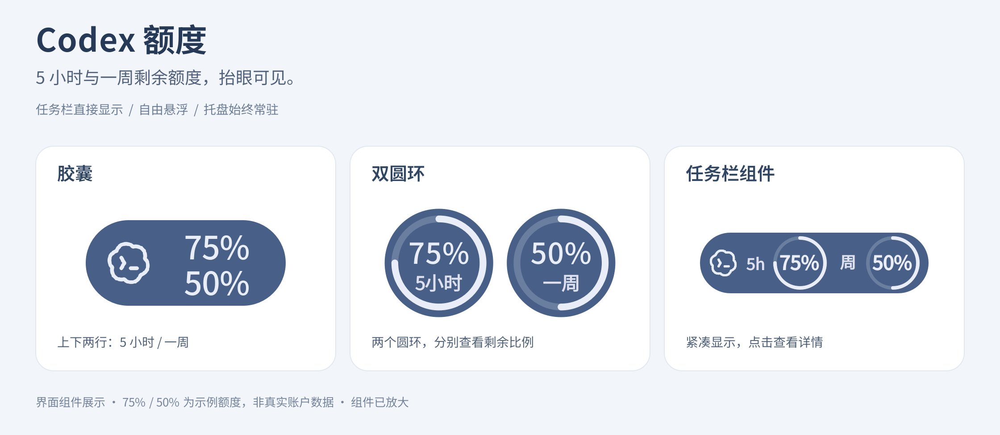
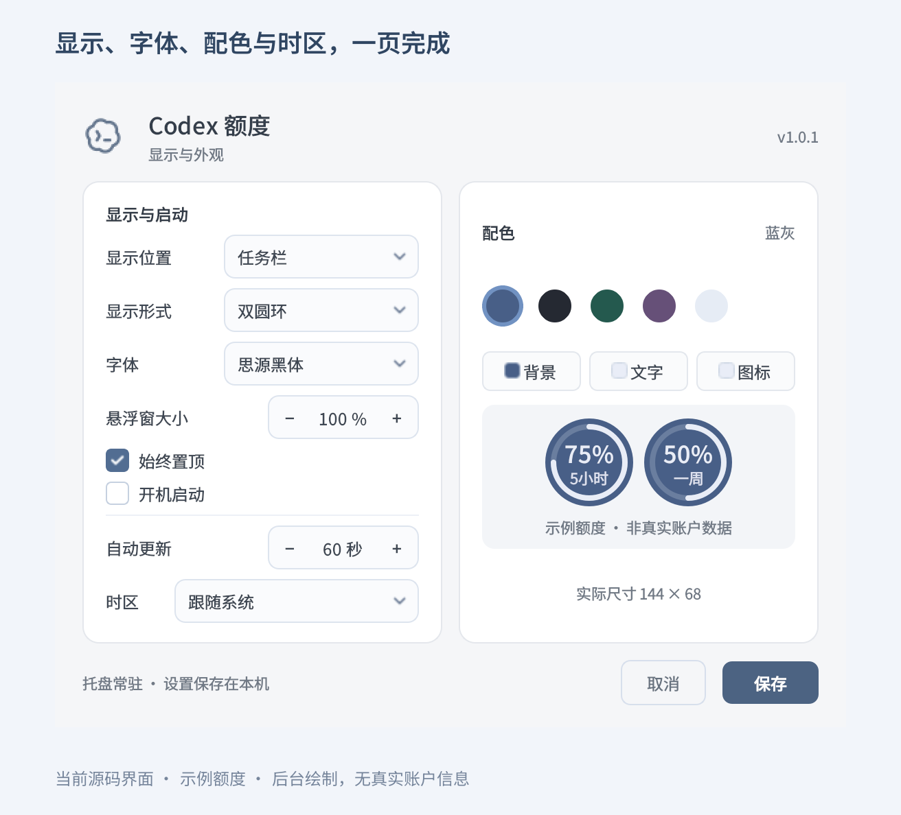
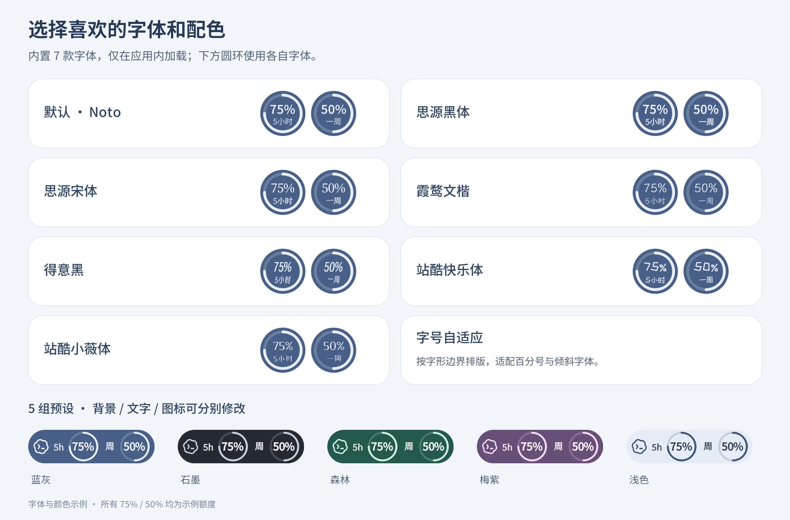

<div align="center">


# Codex Quota Monitor

**Codex 额度监视器**

任务栏显示 · 桌面悬浮窗 · 双圆环与胶囊 · 字体与配色自定义

[下载 Windows 版](https://github.com/ORyong/CodexQuotaMonitor/releases/latest) · [使用说明](#使用说明) · [外观设置](#外观设置) · [问题反馈](https://github.com/ORyong/CodexQuotaMonitor/issues)

</div>



> 图中额度为演示数据，组件已放大展示。

## 项目简介

Codex Quota Monitor 是一款中文 Windows 额度监视工具，可在任务栏或桌面悬浮窗中显示 Codex 的短周期与周周期剩余额度，并提供重置时间、自动刷新和外观设置。

程序使用本机已有的 Codex 登录状态查询额度，不介入登录流程，也不要求安装或使用 Codex CLI。本项目为独立的非官方工具。

## 功能特性

- **任务栏显示**：通过紧凑组件直接查看两项剩余额度。
- **桌面悬浮窗**：支持拖动、置顶、尺寸调整和位置保存。
- **双圆环与胶囊**：提供两种展示形式，点击即可查看重置时间和更新状态。
- **托盘常驻**：在所有显示模式下保留刷新、设置、切换模式和退出入口。
- **外观自定义**：内置七款字体、五组配色，可分别修改背景、文字和图标颜色。
- **独立时区**：支持跟随系统或指定地区，按所选时区显示时间。
- **开机启动**：登录 Windows 后自动运行，并恢复上次设置。

## 下载与运行

**当前版本：[V1.0.1-r3](https://github.com/ORyong/CodexQuotaMonitor/releases/tag/V1.0.1-r3)**

| 下载 | 说明 |
| --- | --- |
| [Windows x64 免安装包](https://github.com/ORyong/CodexQuotaMonitor/releases/download/V1.0.1-r3/CodexQuotaMonitor-1.0.1-Windows-x64.zip) | 解压后直接运行，无需安装 Python |
| [发布版源码](https://github.com/ORyong/CodexQuotaMonitor/releases/download/V1.0.1-r3/CodexQuotaMonitor-1.0.1-source.zip) | 包含应用源码与字体资源 |
| [SHA256 校验文件](https://github.com/ORyong/CodexQuotaMonitor/releases/download/V1.0.1-r3/CodexQuotaMonitor-1.0.1-SHA256SUMS.txt) | 下载文件校验值 |

1. 在 Codex 桌面端完成登录。
2. 下载 Windows 包并完整解压。
3. 双击 `CodexQuotaMonitor.exe` 运行，保留同目录中的 `_internal` 文件夹。

首次运行默认使用任务栏胶囊，每 60 秒自动刷新一次。任务栏嵌入目前在 Windows 10 x64 水平任务栏上验证；无法嵌入时自动使用悬浮窗。

更新时，通过右键菜单退出旧版本，再替换完整程序目录。

## 使用说明

### 显示位置

在设置的 **“显示位置”** 下拉框中选择显示模式：

| 选项 | 额度显示位置 |
| --- | --- |
| 任务栏 | Windows 任务栏中的紧凑组件 |
| 悬浮窗 | 可拖动的桌面组件 |
| 同时显示 | 任务栏与桌面悬浮窗 |

三种模式均保留后台托盘。托盘图标可从 Windows 通知区域或其折叠菜单中找到。

### 额度展示

- **胶囊**：上、下两行分别显示短周期和周周期剩余额度。
- **双圆环**：左、右两环分别显示这两个周期，圆弧长度表示剩余比例。
- **额度详情**：点击组件或托盘图标，查看完整额度、重置时间与更新状态。

通常显示 **5 小时 / 一周** 两项额度，实际周期以服务返回为准。额度耗尽时显示 `0%`，尚无数据时显示 `--`。查询失败会保留上次结果并标记过期。

### 常用操作

| 操作 | 功能 |
| --- | --- |
| 点击额度组件或托盘图标 | 展开详情 |
| 鼠标悬停 | 查看额度、重置时间和更新状态 |
| 右键组件或托盘图标 | 刷新、切换模式、设置、开机启动、退出 |
| 拖动悬浮窗 | 调整并保存位置 |
| 再次运行程序 | 打开当前实例的设置界面 |

## 外观设置



| 设置项 | 说明 |
| --- | --- |
| 显示位置 | 任务栏、悬浮窗或同时显示 |
| 显示形式 | 胶囊或双圆环 |
| 字体 | 七款内置字体，可实时预览 |
| 悬浮窗大小 | 75%–200% |
| 始终置顶 | 控制悬浮窗置顶状态 |
| 开机启动 | 默认关闭，启用后在登录 Windows 时运行 |
| 自动更新 | 默认 60 秒，可设置为 30–3600 秒 |
| 时区 | 跟随系统或选择指定地区，支持夏令时 |
| 配色 | 五组预设，支持自定义背景、文字和图标颜色 |

调整设置后点击“保存”生效，程序会记住上次配置和悬浮窗位置。移动程序目录后，关闭再重新开启“开机启动”即可更新启动路径。

### 字体与配色



| 字体 | 风格 |
| --- | --- |
| Noto Sans SC（默认） | 清晰、简洁 |
| 思源黑体 | 现代、规整 |
| 思源宋体 | 典雅、正式 |
| 霞鹜文楷 | 自然、温润 |
| 得意黑 | 倾斜、个性 |
| 站酷快乐体 | 活泼、圆润 |
| 站酷小薇体 | 纤细、复古 |

预设配色包含 **蓝灰、石墨、森林、梅紫、浅色**。内置字体仅在应用中加载，无需安装到系统。

## 数据读取

程序只读本机已有的 Codex 凭据，通过 Codex 客户端使用的额度接口查询，不修改凭据，不执行登录、令牌续期或退出账号操作。

| 项目 | 位置 |
| --- | --- |
| 默认凭据 | `%USERPROFILE%\.codex\auth.json`，支持 `CODEX_HOME` 自定义目录 |
| 额度接口 | `GET https://chatgpt.com/backend-api/wham/usage` |
| 显示设置 | `%LOCALAPPDATA%\CodexQuotaMonitor\settings.json` |

设置文件仅保存显示偏好，不保存访问令牌或额度响应。额度接口为客户端内部接口，可能随客户端调整。

## 常见问题

| 情况 | 处理方法 |
| --- | --- |
| 提示确认登录状态 | 在 Codex 桌面端确认登录正常后刷新 |
| 显示 `--` | 在详情中查看查询状态，等待刷新 |
| 出现过期标记 | 检查网络后手动刷新 |
| 找不到托盘图标 | 查看 Windows 通知区域的折叠菜单 |
| 设置界面未显示 | 再次运行程序，打开当前实例的设置页 |

## 源码运行

项目使用 **Python + PySide6**，依赖版本见 [requirements.txt](requirements.txt)。

```powershell
git clone https://github.com/ORyong/CodexQuotaMonitor.git
cd CodexQuotaMonitor
python -m venv .venv
.\.venv\Scripts\python.exe -m pip install -r requirements.txt
.\.venv\Scripts\python.exe main.py
```

<details>
<summary>开发与构建命令</summary>

```powershell
# 单元测试
.\.venv\Scripts\python.exe -m unittest discover -s tests -v

# 生成文档配图
.\.venv\Scripts\python.exe tools/render_readme.py

# 构建 Windows 免安装包与源码包
.\.venv\Scripts\python.exe tools/build.py
```

构建目录为 `dist/V1.0.1/CodexQuotaMonitor/`，ZIP 文件输出到 `dist/`。

</details>

## 第三方资源

- [Qt for Python / PySide6](https://doc.qt.io/qtforpython-6/)
- [内置字体与许可证](assets/fonts)
- [字体来源与文件哈希](assets/fonts/SOURCES.json)

Codex 名称和图标的相关权利归其权利人所有。
