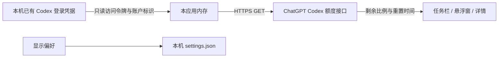

<div align="center">


# Codex Quota Monitor

**把 Codex 剩余额度放到任务栏，或悬浮在桌面。**

5 小时 · 一周 · 双圆环 / 胶囊 · 中文界面

[下载 Windows 版](https://github.com/ORyong/CodexQuotaMonitor/releases/latest) · [界面与用法](#界面与用法) · [隐私与数据](#隐私与数据) · [问题反馈](https://github.com/ORyong/CodexQuotaMonitor/issues)

</div>


> 图片由当前应用组件在后台绘制，所有额度均为示例数据；组件展示图已放大，任务栏组件不代表完整 Windows 桌面截图。

## 它能做什么

- **额度直接显示在任务栏**，不必打开 Codex 查看；也可以使用可拖动、可置顶的悬浮窗。
- **双圆环 / 胶囊两种形式**，分别显示短周期和周周期剩余额度；点击查看重置时间。
- **托盘始终保留**，右键即可刷新、切换显示位置、打开设置或退出。
- **字体与配色可选**，内置 7 款字体、5 组预设，支持分别调整背景、文字和图标颜色。
- **独立时区与开机启动**，记住上次的显示位置、样式、尺寸和悬浮窗坐标。
- **只读现有登录状态**，不要求使用 Codex CLI，也不提供登录、续期或退出账号操作。

这是一个独立的非官方 Windows 工具，与 OpenAI 无隶属关系。

## 下载与运行

**当前发布： [V1.0.1-r3 · 界面与圆环字体修复](https://github.com/ORyong/CodexQuotaMonitor/releases/tag/V1.0.1-r3)**

| 文件 | 用途 |
| --- | --- |
| [Windows x64 免安装包](https://github.com/ORyong/CodexQuotaMonitor/releases/download/V1.0.1-r3/CodexQuotaMonitor-1.0.1-Windows-x64.zip) | 普通用户下载此文件 |
| [源码 ZIP](https://github.com/ORyong/CodexQuotaMonitor/releases/download/V1.0.1-r3/CodexQuotaMonitor-1.0.1-source.zip) | 对应发布版本的源码与字体资源 |
| [SHA256 校验文件](https://github.com/ORyong/CodexQuotaMonitor/releases/download/V1.0.1-r3/CodexQuotaMonitor-1.0.1-SHA256SUMS.txt) | 核对下载文件完整性 |

1. 在 Codex 桌面端完成登录，确保本机已有可读取的登录凭据。
2. 下载并**完整解压** Windows 包，保留整个目录及其中的 `_internal` 文件夹。
3. 双击 `CodexQuotaMonitor.exe`。无需安装 Python，也无需安装或先使用 CLI。
4. 首次运行默认使用**任务栏 + 胶囊**，后台每 60 秒查询一次；在设置中按喜好调整。

无法嵌入当前任务栏时，程序会回退到悬浮窗。任务栏功能的兼容范围见下方说明。

<details>
<summary>可选：用 PowerShell 校验下载文件</summary>

```powershell
Get-FileHash .\CodexQuotaMonitor-1.0.1-Windows-x64.zip -Algorithm SHA256
```

将输出与发布页的 `SHA256SUMS.txt` 对照。更新时先通过右键菜单退出旧程序，再替换完整目录；不要覆盖正在使用的运行库。

</details>

## 界面与用法

### 任务栏、悬浮窗，一个选项切换

在设置的 **“显示位置”** 下拉框中选择：

| 显示位置 | 额度显示区域 | 后台托盘 |
| --- | --- | --- |
| 任务栏 | Windows 任务栏中的紧凑组件 | 始终保留 |
| 悬浮窗 | 桌面上可拖动的小组件 | 始终保留 |
| 同时显示 | 任务栏 + 悬浮窗 | 始终保留 |

没有“仅托盘”模式。托盘是所有显示位置共同保留的操作入口，图标可能被 Windows 收纳到通知区域的折叠菜单中。

| 操作 | 作用 |
| --- | --- |
| 点击任务栏组件、悬浮窗或托盘图标 | 展开额度详情，查看重置时间、刷新或进入设置 |
| 鼠标悬停 | 查看两项额度、重置时间及更新状态 |
| 右键组件或托盘图标 | 切换显示位置、立即刷新、设置、开机启动、退出 |
| 拖动悬浮窗 | 调整位置，释放后保存 |
| 再次运行程序 | 打开已运行实例的设置界面 |

### 胶囊与双圆环

**胶囊**的上、下两行分别是短周期和周周期额度；**双圆环**的左、右两环分别对应这两个周期。圆弧长度表示**剩余额度**，圆心显示剩余百分比。

通常为 **5 小时 / 一周**，实际周期以接口返回为准。显示值取 `100 − used_percent`，限制在 0–100% 范围并向下取整；没有数据时显示 `--`，耗尽时显示 `0%`。

| 样式 | 悬浮窗默认尺寸 | 任务栏尺寸 |
| --- | --- | --- |
| 胶囊 | 112 × 48 | 104 × 34 |
| 双圆环 | 144 × 68 | 128 × 34 |

以上为逻辑像素，实际显示随系统 DPI 缩放。悬浮窗大小可在设置中调整为 75%–200%。

### 设置集中在一页


- **自动更新**：默认 60 秒，可设置为 30–3600 秒；网络请求在后台执行，也可以手动刷新。
- **时区**：默认跟随系统，也可选择北京、洛杉矶、纽约、伦敦等时区。仅影响本软件中的时间显示，按所选地区规则处理夏令时。
- **开机启动**：默认关闭；启用后在登录 Windows 时启动，沿用上次设置。只写入当前用户的启动项，无需管理员权限。移动程序目录后，请关闭再重新开启此选项以更新路径。
- **始终置顶**：控制悬浮窗是否置顶。

### 字体与配色


| 字体 | 界面风格 |
| --- | --- |
| Noto Sans SC（默认） | 清晰、简洁 |
| 思源黑体 | 现代、规整 |
| 思源宋体 | 典雅、正式 |
| 霞鹜文楷 | 自然、温润 |
| 得意黑 | 倾斜、有个性 |
| 站酷快乐体 | 活泼、圆润 |
| 站酷小薇体 | 纤细、复古 |

字体随程序分发，仅在应用进程内加载，不安装到 Windows。思源黑体数字另带 Medium 字重；双圆环按照实际字形边界居中并自适应字号。

## 隐私与数据



- 默认读取 `%USERPROFILE%\.codex\auth.json`；若设置了 `CODEX_HOME`，则读取该目录下的 `auth.json`。
- 使用已有访问令牌与账户标识，请求 `GET https://chatgpt.com/backend-api/wham/usage`。认证信息只用于向该服务发起查询；请求禁止跟随重定向。
- 不修改 Codex 凭据或配置，不实现登录、授权、令牌续期、退出账号或额度重置，不上传到项目作者的服务器。
- 正常运行不写入凭据日志，也不把额度响应保存到设置文件。外观与显示偏好保存于 `%LOCALAPPDATA%\CodexQuotaMonitor\settings.json`。
- 开机启动启用时，另在当前用户的 `HKCU\Software\Microsoft\Windows\CurrentVersion\Run` 中维护本程序启动项。
- 凭据、用户设置、真实账户截图及私有测试报告不包含在仓库和发布包中。README 图片使用固定示例额度。

额度接口属于客户端内部接口，字段或认证机制可能变化。程序遇到异常会显示错误，不会补入虚构额度。

## 常见问题

| 情况 | 处理方式 |
| --- | --- |
| 提示“请在 Codex 桌面端确认登录状态” | 在 Codex 桌面端确认登录正常后手动刷新。本工具不会代为登录或续期，也不需要先使用 CLI |
| 一项或两项显示 `--` | 尚未取得数据，或服务未返回对应窗口；在详情中查看状态 |
| 出现黄色提示点 / “数据已过期” | 查询失败，界面保留本次运行中上次成功的结果；检查网络后刷新 |
| 提示查询过于频繁 | 稍后重试，避免连续手动刷新 |
| 提示接口格式发生变化 | 记录不含账号信息的提示，通过 Issues 反馈；不要上传 `auth.json` |
| 任务栏里没有组件，但出现悬浮窗 | 当前任务栏无法嵌入，程序已回退；可继续使用悬浮窗 |
| 找不到托盘图标 | 查看 Windows 通知区域的折叠菜单，按需将图标设置为始终显示 |
| 点击设置未显示 | 使用最新版；也可再次运行 EXE，唤出当前实例的设置页 |
| 旧版报 QtCore DLL 导入错误 | 完整退出旧程序后，解压最新版到新目录运行，勿混用旧版运行库 |

## 兼容范围与验证

当前验收环境为 **Windows 10 x64（19045）**。任务栏嵌入已在**水平任务栏**验证；Windows 11、竖直任务栏和第三方任务栏尚未验收，无法嵌入时回退到悬浮窗。

已覆盖额度解析与异常处理、设置保存、只读凭据、时区、字体加载、托盘常驻及单实例行为。初次 V1.0.1 构建检查了 100%、125%、200% Qt 缩放；后续界面修复使用后台绘制验证，并核对冻结程序与受测源码一致。详细范围及限制见 [验证说明](VALIDATION.md)。

尚未完成实体双屏插拔、重启电脑后的自动启动、Explorer 重启恢复及全新离线电脑验收。后台渲染检查不等同于这些实机验收。

## 从源码运行

普通用户直接下载 Windows 包即可。开发与打包环境已验证 **Python 3.14.2、PySide6 6.11.0、PyInstaller 6.20.0**。

```powershell
git clone https://github.com/ORyong/CodexQuotaMonitor.git
cd CodexQuotaMonitor
python -m venv .venv
.\.venv\Scripts\python.exe -m pip install -r requirements.txt
.\.venv\Scripts\python.exe main.py
```

运行时同样需要本机已有的 Codex 登录凭据；不要把凭据复制到项目目录。

### 检查与打包

```powershell
# 单元测试
.\.venv\Scripts\python.exe -m unittest discover -s tests -v

# 只用示例数据生成 README 配图：无可见窗口、不读取凭据、不查询网络
.\.venv\Scripts\python.exe tools/render_readme.py

# 构建免安装目录和 ZIP
.\.venv\Scripts\python.exe tools/build.py

# 发布候选文件隐私检查（构建后运行）
.\.venv\Scripts\python.exe tools/privacy_audit.py
```

构建目录为 `dist/V1.0.1/CodexQuotaMonitor/`，Windows 与源码 ZIP 位于 `dist/`。构建使用隔离的 DLL 搜索路径，避免其他软件运行库混入。历史发布包保持原样，仓库文档可在发布后继续更新。

完整 GUI 验收命令为 `python tools/acceptance.py`，**会打开测试窗口、检查真实任务栏并查询额度**，应在独立测试桌面或测试环境运行。

### 源码导览

| 路径 | 内容 |
| --- | --- |
| [`quota_monitor/client.py`](quota_monitor/client.py) | 只读凭据、查询服务和响应解析 |
| [`quota_monitor/app.py`](quota_monitor/app.py) | 悬浮窗、任务栏组件、详情与设置 |
| [`quota_monitor/taskbar.py`](quota_monitor/taskbar.py) | Windows 原生任务栏嵌入 |
| [`quota_monitor/rings.py`](quota_monitor/rings.py) | 双圆环与文字排版 |
| [`quota_monitor/settings.py`](quota_monitor/settings.py) | 显示偏好与配色 |
| [`quota_monitor/startup.py`](quota_monitor/startup.py) / [`timezones.py`](quota_monitor/timezones.py) | 当前用户开机启动 / 应用时区 |
| [`assets/fonts/`](assets/fonts) | 内置字体、来源与原始许可证 |
| [`tests/`](tests) / [`tools/`](tools) | 测试、构建、隐私检查与示例图生成 |

## 第三方资源

界面使用 [Qt for Python / PySide6](https://doc.qt.io/qtforpython-6/)。字体保留各自的原始许可证，下载来源与文件哈希见 [`assets/fonts/SOURCES.json`](assets/fonts/SOURCES.json)，授权文本见同目录中的 `OFL.txt` 和各字体的 `LICENSE` / `OFL` 文件。Codex 名称和图标的相关权利归其权利人所有。

反馈时请附 Windows 版本、显示模式、缩放比例和错误文字；截图前遮挡个人信息，**请勿提交访问令牌或 `auth.json`**。
